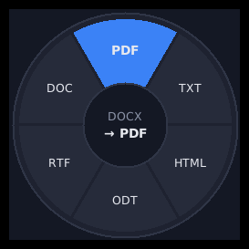

# EasyChange

Change a file's type in two keystrokes. Select a file in File Explorer, press
**Alt+8**, and a small wheel pops up with the formats that file can become. Click
one, and the converted copy is saved right next to the original.



> **Alt+8 is the only way to open EasyChange.** There's no app window or tray
> icon. It waits quietly in the background until you press the shortcut.

---

## Contents

1. [What you need](#1-what-you-need)
2. [Install Python](#2-install-python)
3. [Build EasyChange](#3-build-easychange)
4. [Turn it on](#4-turn-it-on)
5. [How to use it](#5-how-to-use-it)
6. [What converts to what](#6-what-converts-to-what)
7. [Optional extras (Word/PDF, audio and video)](#7-optional-extras)
8. [Changing the shortcut](#8-changing-the-shortcut)
9. [Moving, updating and uninstalling](#9-moving-updating-and-uninstalling)
10. [Troubleshooting](#10-troubleshooting)

---

## 1. What you need

* Windows 10 or Windows 11
* Python 3.10 or newer (only needed once, to build the program)
* About 5 minutes

You don't need admin rights. Everything is installed for your user account only.

## 2. Install Python

Skip this if `py --version` in PowerShell already prints `Python 3.x.x`.

**Option A: one command.** Open PowerShell and run:

```powershell
winget install -e --id Python.Python.3.12
```

**Option B: from the website.** Download Python from
<https://www.python.org/downloads/> and run the installer. On the first screen,
**tick "Add python.exe to PATH"** and then click **Install Now**.

Then **close PowerShell and open a new window**, and check it worked:

```powershell
py --version
```

> **"Program 'python.exe' failed to run: The system cannot find the path
> specified"?** That's the Microsoft Store placeholder, not real Python. Use
> `py` instead of `python` (as all the commands here do). You can also open
> Settings → search **"app execution aliases"** and turn off `python.exe` and
> `python3.exe`.

## 3. Build EasyChange

1. **Pick a permanent home for the folder first.** EasyChange runs from wherever
   it is when you turn it on. A good spot is `C:\Tools\easychange`. Avoid the
   Desktop or Documents if they sync to OneDrive, because OneDrive can move files
   to the cloud and the shortcut then stops working.
2. Unzip `easychange.zip` there.
3. Open PowerShell in that folder:

   ```powershell
   cd C:\Tools\easychange
   ```

4. Build it. This takes a minute or two:

   ```powershell
   powershell -ExecutionPolicy Bypass -File build.ps1
   ```

   It should end with `Build complete!`. You may see yellow warnings that say
   "...is installed in ... which is not on PATH". Those are harmless, so ignore
   them.

   <details>
   <summary>If the build script won't run, use these two commands instead</summary>

   ```powershell
   py -m pip install -r requirements.txt pyinstaller
   ```

   ```powershell
   py -m PyInstaller --noconfirm --clean --windowed --onedir --name EasyChange --hidden-import win32timezone easychange.pyw
   ```

   </details>

## 4. Turn it on

```powershell
dist\EasyChange\EasyChange.exe --install
```

A message box confirms it's installed. From now on:

* Alt+8 works immediately.
* It starts automatically every time you log in to Windows.

## 5. How to use it

1. In File Explorer (or on your desktop), **click a file once** to select it.
2. Press **Alt+8**. The wheel opens at your mouse pointer.
3. Pick a format:

| To... | Do this |
|---|---|
| Highlight a format | Hover over it, scroll the mouse wheel, or use the arrow keys |
| Convert | Click it, or press **Enter** (or **1–8** to pick a slot directly) |
| Cancel | **Esc**, right-click, click the middle of the wheel, or click anywhere else |
| See more formats | If there are more than 8, keep scrolling. The wheel turns, and the counter under the middle (e.g. `10/12`) shows where you are |

The middle of the wheel shows the file's current type and the type you're about
to convert to (e.g. `DOCX → PDF`).

**After converting**

* A green bar shows **"Saved report.pdf"**. Click it to open the folder with
  the new file selected.
* The new file is saved **in the same folder** as the original, with the same
  name and the new extension.
* **The original file is never changed or deleted.**
* If a file with that name already exists, it's saved as `report (2).pdf`
  instead of overwriting it.
* If something goes wrong, a red bar explains why.

**Other messages**

| Message | Meaning |
|---|---|
| **No available file types to change to** | That type of file can't be converted on your PC (see section 6). |
| **Select a file first** | You pressed Alt+8 in Explorer without a file selected (or with only a folder selected). |

**Tips**

* Point your mouse at the file before pressing Alt+8 so the wheel appears over it.
* If several files are selected, only the first one is converted.
* Alt+8 only does something when File Explorer or the desktop is the active
  window. In every other app, Alt+8 behaves normally.
* Only the **8 above the letters** works, not numpad 8. Alt + numpad numbers is
  how Windows types special characters, so EasyChange leaves it alone.

## 6. What converts to what

The wheel only ever shows conversions that will actually work on your PC. If
something you expect is missing, you probably need one of the
[optional extras](#7-optional-extras).

| From | To | Works out of the box? |
|---|---|---|
| **Images:** png, jpg, webp, gif, bmp, tiff, ico | each other, pdf | ✅ Yes |
| **Spreadsheets:** csv ↔ xlsx | | ✅ Yes |
| **Data:** csv ↔ json | | ✅ Yes |
| **Markdown:** md → html, md ↔ txt | | ✅ Yes |
| **Word:** docx → txt | | ✅ Yes |
| **PDF:** pdf | png, jpg, webp, txt | ✅ Yes |
| **PDF:** pdf | docx (editable) | Needs Microsoft Word |
| **Documents:** docx, doc, odt, rtf | pdf, txt, html, odt, rtf, doc, docx | Needs Microsoft Word **or** LibreOffice |
| **Spreadsheets:** xlsx, xls, ods, csv | pdf, xlsx, xls, ods, csv | Needs Microsoft Excel **or** LibreOffice |
| **Presentations:** pptx, ppt, odp | pdf, pptx, odp, ppt | Needs Microsoft PowerPoint **or** LibreOffice |
| **Text:** txt | docx, odt, pdf | Needs LibreOffice |
| **Audio:** mp3, wav, flac, ogg, m4a, aac, opus | each other | Needs ffmpeg |
| **Video:** mp4, mkv, mov, avi, webm | each other, gif, mp3, wav | Needs ffmpeg |

Some notes on how conversions behave:

* **"Adobe Acrobat Document" files are PDFs.** That's just the name Explorer
  shows in the *Type* column when Acrobat is your default PDF app. The file
  still ends in `.pdf`, and EasyChange treats it as a PDF. The same goes for
  "Microsoft Edge PDF Document" and similar names.
* **PDF → images:** a one-page PDF becomes a single image (`report.png`). A
  longer PDF becomes a folder, `report (png pages)`, with one image per page
  (`page 1.png`, `page 2.png`, ...).
* **PDF → txt** only works for PDFs with real text. Scanned PDFs are pictures of
  text, so you'll get a "No text found" message.
* **PDF → docx** uses Word's own PDF converter. Simple documents come out well,
  but complex layouts may shift.
* **Transparent images** (e.g. PNG logos) get a white background when converted
  to formats without transparency (jpg, bmp, pdf).
* **CSV files** separated by `;` or tabs are detected automatically.
* **xlsx → csv** uses the first sheet.
* **json → csv** needs the JSON to be a list of objects (a table). Anything else
  shows an error.
* **Office conversions** run in a hidden, separate copy of Word/Excel/PowerPoint,
  so documents you have open aren't affected. The first one can take a few
  seconds while Office starts up.

## 7. Optional extras

Install these to unlock more formats. EasyChange finds them automatically, with
no setup needed.

**For documents and PDFs** (if you don't have Microsoft Office): install
[LibreOffice](https://www.libreoffice.org/download/download/) (free).

**For audio and video:** install ffmpeg:

```powershell
winget install -e --id Gyan.FFmpeg
```

After installing ffmpeg, restart the background listener so it sees ffmpeg
(or just sign out and back in):

```powershell
dist\EasyChange\EasyChange.exe --install
```

## 8. Changing the shortcut

If Alt+8 clashes with another app (you'll get a message saying it's already in
use), or you just prefer another key:

1. Open this file in Notepad:

   ```powershell
   notepad $env:LOCALAPPDATA\EasyChange\config.json
   ```

2. Change the value, e.g.

   ```json
   { "hotkey": "ctrl+alt+c" }
   ```

3. Save, then restart the listener:

   ```powershell
   dist\EasyChange\EasyChange.exe --install
   ```

Shortcuts are written as modifiers + one key, joined by `+`:

* **Modifiers:** `alt`, `ctrl`, `shift` and `win`. At least one is required.
* **Key:** a letter, a digit, or `F1`–`F24`

## 9. Moving, updating and uninstalling

**Turn it off / uninstall**

```powershell
dist\EasyChange\EasyChange.exe --uninstall
```

This stops Alt+8 and stops it from starting with Windows. Then delete the folder
if you want. Your settings stay in `%LOCALAPPDATA%\EasyChange` (delete that
folder too for a full cleanup).

**Move the folder**

Run `--uninstall`, move the folder, then run `--install` from the new location.

**Update to a new version**

Run `--uninstall`, replace the folder's contents with the new version, then
repeat [step 3](#3-build-easychange) and [step 4](#4-turn-it-on).

## 10. Troubleshooting

**Nothing happens when I press Alt+8**

* Make sure File Explorer or the desktop is the active window (click on it first)
  and a **file** (not a folder) is selected.
* Use the 8 above the letters, not numpad 8.
* The listener may not be running (e.g. you moved the folder). Run
  `dist\EasyChange\EasyChange.exe --install` again.
* Check Task Manager → **Details** for `EasyChange.exe`. Exactly one should be
  running in the background.

**"The shortcut ALT+8 is already used by another app"**

Another program has claimed Alt+8. Pick a different shortcut, as described in
[section 8](#8-changing-the-shortcut).

**The format I want isn't on the wheel**

It needs a program that isn't installed. Check the table in
[section 6](#6-what-converts-to-what) and install the
[extra](#7-optional-extras) it needs.

**A conversion failed (red bar)**

The bar shows a short reason. The full details are in the log file:

```powershell
notepad $env:LOCALAPPDATA\EasyChange\easychange.log
```

Common causes: the file is damaged, password-protected, or still open and locked
by another program.

**The wheel has a coloured box around it instead of being round**

This can happen with some display or accessibility settings. It doesn't affect
how it works.

**Windows Defender or SmartScreen warns about EasyChange.exe**

This happens with programs you build yourself, because they aren't signed. The
code is all in this folder for you to check.

---

## For developers

Run straight from source without building:

```powershell
py -m pip install -r requirements.txt
```

```powershell
py easychange.pyw --install
```

Command-line options:

```
EasyChange.exe --install              turn on Alt+8 (and start at login)
EasyChange.exe --uninstall            turn everything off
EasyChange.exe --list <file>          print the formats a file can be converted to
EasyChange.exe --convert pdf <file>   convert without the wheel
```

Run the tests:

```powershell
py -m pip install pytest
```

```powershell
py -m pytest tests
```

Project layout:

| File | What it does |
|---|---|
| `easychange/converters.py` | Every supported conversion and the program used for it |
| `easychange/wheel.py` | The pop-up wheel and message bars |
| `easychange/hotkey.py` | The Alt+8 listener and reading the Explorer selection |
| `easychange/install.py` | Turning the listener on and off |
| `easychange/config.py` | Settings and log file locations |
